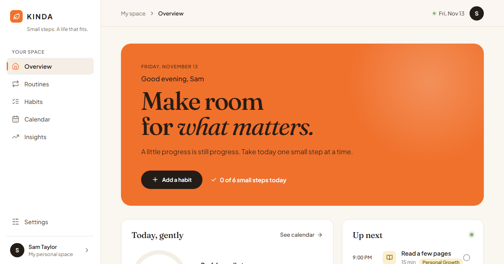

# KINDA — Small steps. A life that fits.

A gentle habit tracker designed around real life, not perfect streaks.

**Live demo:** https://jpicadocorrales-png.github.io/KINDA/



## The idea

Most habit trackers reward streaks, so one missed day can feel like failure. KINDA is built on the opposite idea: plans should flex with real life, a smaller version of a habit still counts, and missing a day is information, not a setback.

## Design decisions

- **Routines that bend instead of break.** Routines can run on specific days or "a few times a week", at an exact time or within a flexible window.
- **Minimum versions.** Each routine can define what still counts on a low-energy day, and each habit can have a two-minute "tiny version".
- **Anchors (habit stacking).** Routines can be tied to something you already do ("After morning coffee"), which is easier to remember than a time on the clock.
- **Patterns, not grades.** Insights reads your plan and history and suggests what to adjust, with each suggestion linking straight to the routine to change.
- **Live feedback while editing.** The editors show a one-line summary that updates as you type, so you always see the result of your choices.

## Visual system

- **Color with one meaning each.** Ember orange marks focus (the hero, today, where you are). Sage marks growth (progress, done). Butter marks warmth (tips, small wins). Warm neutrals carry everything else.
- **Two typefaces, one rule.** Fraunces is for titles and numbers; Plus Jakarta Sans is for everything you read or click.
- **Tokens.** Every color, type size, space and radius comes from tokens defined in [`src/styles.css`](src/styles.css).
- **Responsive and accessible.** Layouts adapt from desktop to a 375px phone, and focus states, labels and reduced-motion support are built in.

## Features

- **Overview:** the day at a glance, progress, routines, upcoming habits and a pattern spotlight
- **Routines:** full editor (days, time window, duration, habits, reminders, anchor, minimum version, icon, notes), plus search, pause, duplicate and delete
- **Habits:** editor with icon, category, frequency, routine, tiny version and notes, plus filters and search
- **Calendar:** Day, Week, Month and Year views
- **Insights:** metrics, weekly consistency and a filterable list of patterns

Data is saved in the browser (localStorage), and first-time visitors start with a sample plan.

## Built with

React 18, TypeScript, Vite, Lucide icons. The site deploys to GitHub Pages through GitHub Actions on every push to `main`.

## Run locally

```bash
npm install
npm run dev
```
